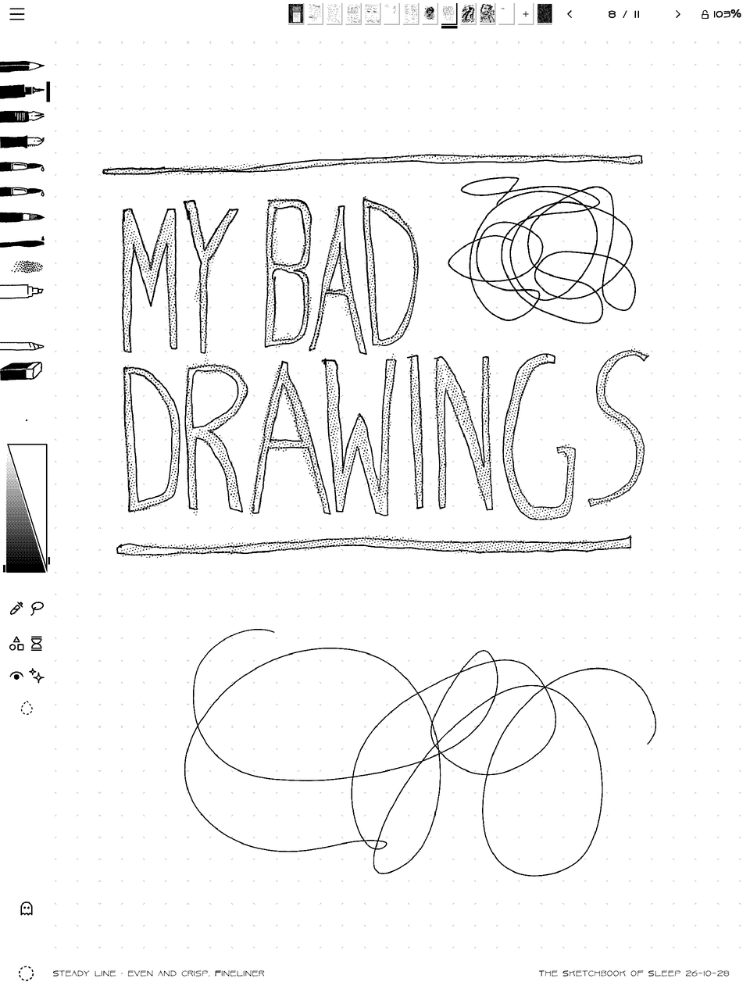

# My Bad Drawings



A sketchbook journal thing for  Supernote Manta e-ink tablet, with notebooks to fill with handwriting, drawing and doodling, and a set of tools that are useful, and sometimes (delightfully?) unpredictable. 

## Built on MonoPaint

This app is a fork of the wonderful [MonoPaint](https://github.com/mpdairy/monopaint) by mpdairy. Its fast e-ink pen
path, documents, layers and wet media are MonoPaint's work, and the fork keeps MonoPaint's MIT notice
([LICENSE](LICENSE)). If you want a full painting app, use MonoPaint! 

## About My Bad Drawings

- **Notebooks** on a shelf, up to 100 pages each, with covers, templates and a possibility of adding unusual constraints, like no erasing, one brush,
  and timed pages. Saved as you go on the tablet.
- **A brush engine**: every brush is built using six modules -- Tip, Medium, Smudge, Paper, Drying, and Control -- and can generate a short
  share code. There are ten tool slots on the side bar and a library of brushes (some pens, pencils, markers, charcoal, ink wash,
  watercolour, gouache, oils) and you can tweak them in app in the **Brush Lab**.
- **[Brush Studio](https://ell.ing/brush-studio/)** is a web brush making companion that reads and writes the same codes.
- **Some Mischief**: I played around with weird ideas, like ink that fades or appears later (Fading, Lemon Juice), Mold growing on paint, momentum mark finishes, Spirograph, Stamp, mirrors on the canvas, fridge-magnet words, and a Self-Portrait Prompt.

Whatever is new will be in [CHANGELOG.md](CHANGELOG.md); a tour of the screens is in [docs/TOOLS.md](docs/TOOLS.md).

## Install

### From a release

1. Download `my-bad-drawings-0.9.apk` from the [latest release](https://github.com/ellinglien/my-bad-drawings/releases/latest).
2. On the tablet, turn on Sideloading in its settings, and connect it by USB to a computer with Google's
   [platform tools](https://developer.android.com/tools/releases/platform-tools) (`adb devices` should list it).
3. Install it and compile it ahead of time, which keeps drawing smooth on the tablet:

   ```sh
   adb install -r my-bad-drawings-0.9.apk
   adb shell cmd package compile -m speed -f ing.ell.mybaddrawings
   ```
4. Open My Bad Drawings and allow file access when it asks: notebooks live in `Document/My Bad Drawings`, where
   they survive updates and reinstalls.

Later releases install over it with the same commands.

### From source

Details in [docs/BUILDING.md](docs/BUILDING.md):

1. Install [Android Studio](https://developer.android.com/studio) (for JDK 21 and the Android SDK), then in its SDK
   Manager add Android 14 (API 34), NDK 27.0.12077973 and CMake 3.22.1.
2. On the tablet, turn on Sideloading in its settings, and connect it by USB (`adb devices` should list it).
3. In this folder:

   ```sh
   export JAVA_HOME="/Applications/Android Studio.app/Contents/jbr/Contents/Home"   # macOS; elsewhere, Studio's jbr
   export ANDROID_HOME="$HOME/Library/Android/sdk"                                  # where the SDK Manager put it
   ./gradlew :app:assembleRelease
   adb install -r app/build/outputs/apk/release/app-release.apk
   adb shell cmd package compile -m speed -f ing.ell.mybaddrawings
   ```

   The last line compiles the app ahead of time, which keeps drawing smooth on the tablet. Without a release key
   of your own the build is signed with Android's debug key; that's fine for your own tablet.
4. Open My Bad Drawings and allow file access when it asks: notebooks live in `Document/My Bad Drawings`.

It's made for and tested on the Supernote Manta. **It has never been tried on a Nomad:** the Nomad layouts were
built blind, from its screen size alone, so expect rough edges there (reports welcome). Other Android tablets are
untested.

## Made with AI

This app was built with AI: the code is AI-generated (Anthropic's Claude, through Claude Code), directed, tried on
the tablet and shaped by me. See [AI_DISCLOSURE.md](AI_DISCLOSURE.md).

## Development

`bash scripts/test_inkwash.sh` runs the desktop checks (JDK and Node.js). See [CONTRIBUTING.md](CONTRIBUTING.md),
[docs/ARCHITECTURE.md](docs/ARCHITECTURE.md) for the code, and [docs/INTEGRATION.md](docs/INTEGRATION.md) for what
differs from MonoPaint.

## Licence

[MIT](LICENSE), © mpdairy (MonoPaint) and Elling Lien (the fork). Fonts, icons, paper textures and the pen bridge
come from others under their own terms: see [THIRD_PARTY_NOTICES.md](THIRD_PARTY_NOTICES.md).
