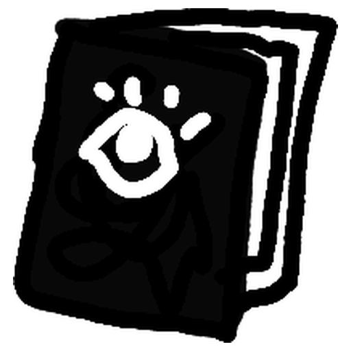

# MonoPaint



A small drawing app for the **Supernote Manta** and **Nomad**. Pressure-sensitive
brushes, watercolor that runs when you tilt the tablet, textured pencil, dotted
grayscale shading, and a blending stump for sketching on e-ink.

[Download the latest APK](https://github.com/mpdairy/monopaint/releases/latest/download/monopaint.apk)
· [All releases and release notes](https://github.com/mpdairy/monopaint/releases)

## What it does

- Round, Flat and Filbert brushes with pressure and tilt, plus oil paint that runs out and smudges.
- Watercolor mode for brushes, shapes and fills: washes that blend, bleed and run downhill as you tilt, plus a blow dryer to stop them.
- A wetness slider for a wet canvas, and dry and wet brush pens that push paint around with water.
- Masking fluid that keeps paint off an area until you peel it.
- Pencil, airbrush, eraser, blending stump, flat and gradient fills, and shapes.
- 65 grayscale shades, an eyedropper, a swatch palette, and an eraser color for any tool.
- Up to 8 layers per page, multiple pages you can duplicate, undo/redo (or tap with two or three fingers), and custom saved tools.
- Portrait or landscape for either drawing hand, plus lockable pinch zoom.
- Saves as you work, locally. No account or network access.

**[Tool and feature guide](docs/TOOLS.md)**: what every icon does and how to use it.

## Sideload onto a Manta

1. Download **monopaint.apk** from the [latest release](https://github.com/mpdairy/monopaint/releases/latest) (not the source ZIP).
2. Install Google's [Android SDK Platform Tools](https://developer.android.com/tools/releases/platform-tools)
   on your computer and open a terminal in the folder containing `adb`.
3. On the Manta, turn on **Settings → Security & Privacy → Sideloading**.
   Connect it by USB, unlock it, and accept the debugging prompt if one appears.
4. Run the commands below, replacing the APK path with your download location:

   ```sh
   adb devices
   adb install -r /path/to/monopaint.apk
   adb shell am start -n dev.tilesmile.supernote.paint/io.github.mpdairy.monopaint.PaintActivity
   ```

   On Windows PowerShell, use `./adb.exe`; on macOS/Linux, use `./adb` if it
   isn't on your PATH. If multiple devices appear, add `-s SERIAL` after `adb`.
   If a device is `unauthorized`, approve the prompt on the tablet and retry.

For updates, repeat `adb install -r` with the new APK. The app ID remains
`dev.tilesmile.supernote.paint`, so releases signed with the existing key also
update the earlier TileSmile and Mattelier apps.
Do not uninstall first: uninstalling deletes paintings still kept in the app's private storage.

## Saving

There is no Save button: MonoPaint saves as you work. A **New painting** is kept
inside the app until you name it with **Menu → Save painting as…**; from then on
it saves to that file by itself, and Save painting as… again makes a copy under
a new name and keeps working in the copy. Once you allow file access, which MonoPaint asks
for at launch, paintings are `.mpaint` files in `Document/MonoPaint` on a
Supernote (`Documents/MonoPaint` on other tablets), where they survive
uninstalling the app. Until then they stay in the app's private storage, and
**uninstalling deletes them**. See the [guide](docs/TOOLS.md#saving) for
details and PNG conversion.

## Current limits

This is an early, unofficial app tested on the **Supernote Manta (1920 × 2560)**
and **Nomad (1404 × 1872)**, both arm64, including Supernote firmware 3.30.45. Other tablets are unverified: the fast
e-ink path needs a supported Supernote screen, and other tablets use the slower
Android drawing fallback. Undo history does not survive a restart.

If you try MonoPaint on another tablet, [open an issue](https://github.com/mpdairy/monopaint/issues)
with your device, firmware and app versions, whether pressure/tilt works, and how
live ink, grays, and selection refreshes behave. Test on a new painting first.

## Development and license

See [building, testing, and publishing](docs/BUILDING.md) and
[contributing](CONTRIBUTING.md). Technical research notes are in [docs](docs/).
Earlier notes use the working names TileSmile and Mattelier; compatibility details
are in the [development guide](docs/BUILDING.md#project-names-and-compatibility).

[MIT licensed](LICENSE). The pen bridge includes MIT-licensed work from
[AnimInk](https://github.com/YoramDevGH/AnimInk); its attribution is retained in
[THIRD_PARTY_NOTICES.md](THIRD_PARTY_NOTICES.md) and inside the APK.
